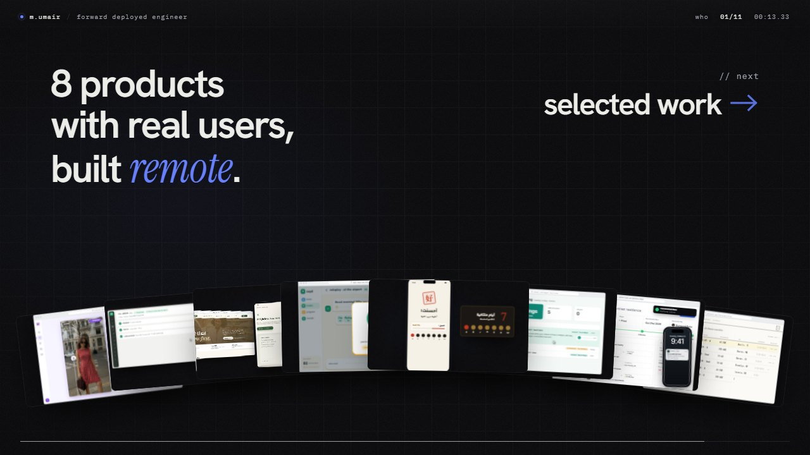

<h3 align="center">Mohammad Umair</h3>

Forward Deployed Engineer · Founder @ <a href="https://prevyou.app">prevyou</a> I build ai things that ship. mostly backend, sometimes full-stack when needed.

  
  
  

  
   ▶ eight products, start to finish. <a href="https://mohammadumair.vercel.app/#walkthrough">watch the walkthrough</a>

---

### Now

- **Forward Deployed** at [TheChemistLive](https://thechemistlive.com), a uk online pharmacy. built the system their day runs on: orders from ebay, groupon, onbuy and their own store, all the way to a packed parcel.
- **Founder** of [prevyou](https://prevyou.app), an ai try-on studio for clothes and hair. we launched it in 2026.

### Selected work

| Project | What it is |
|---|---|
| **[prevyou](https://mohammadumair.vercel.app/work/prevyou)** | see an outfit, or a haircut, on you before you buy or book. [prevyou.app](https://prevyou.app) |
| **[crm hub](https://mohammadumair.vercel.app/work/crm-hub)** | the back office that runs an online pharmacy, from health questionnaire to parcel. |
| **[lord street pharmacy](https://mohammadumair.vercel.app/work/lord-street-pharmacy)** | an independent pharmacy's website. two clinics, one front door. [live](https://www.lordstreetpharmacy.co.uk) |
| **[zayd ai](https://mohammadumair.vercel.app/work/zayd-ai)** | an english tutor for saudi schools that scores every word you say. 1,300 active learners. |
| **[nihaonow](https://mohammadumair.vercel.app/work/nihaonow)** | mandarin for arabic speakers, with feedback spoken back in arabic. |
| **[clinic voice agent](https://mohammadumair.vercel.app/work/clinic-voice-agent)** | picks up clinic calls 24/7 and books the appointment. |
| **[permit labs](https://mohammadumair.vercel.app/work/permit-labs)** | the first public api and docs for a solar permitting platform. [docs](https://docs.permitlabs.ai/api/) |
| **[siftwork](https://mohammadumair.vercel.app/work/siftwork)** | company research, without all the tabs. |

### stack

  

ai: openai · azure openai · anthropic · langchain · pydantic ai · pinecone · retell integrations: ebay · stripe · twilio · royal mail · cliniko · nookal · coreplus

---

shipped 6+ ai products to real users. email is above. i actually check it.

  

